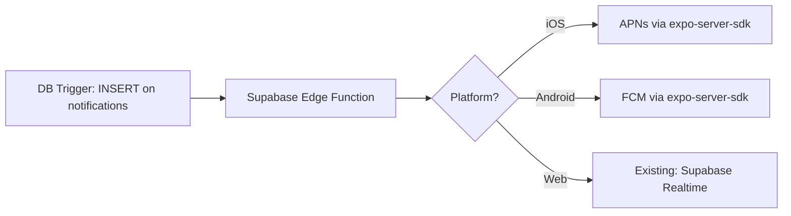

# 📱 HUDdang — Mobile Portability Audit

> **Generated**: August 15, 2026  
> **Scope**: Full codebase analysis for React Native mobile app viability  
> **Target**: React Native (Expo) via monorepo alongside existing Next.js web app  

---

## Table of Contents

1. [Introduction](#1-introduction)
2. [Bucket 1 — Directly Portable](#2-bucket-1--directly-portable)
3. [Bucket 2 — Needs Adaptation](#3-bucket-2--needs-adaptation)
4. [Bucket 3 — Web-Only, Needs Full Reimplementation](#4-bucket-3--web-only-needs-full-reimplementation)
5. [Monorepo Recommendation](#5-monorepo-recommendation)
6. [Supabase RLS & Auth Considerations for Mobile](#6-supabase-rls--auth-considerations-for-mobile)
7. [Top 3 Technical Decisions Before Mobile Development](#7-top-3-technical-decisions-before-mobile-development)
8. [Rough Migration Plan](#8-rough-migration-plan)

---

## 1. Introduction

The HUDdang codebase is a Next.js 16 (App Router) application using Supabase as the backend (PostgreSQL, Auth, Realtime, Storage), Zustand for state management, Framer Motion for animations, LiveKit for voice/video calls, and Tailwind CSS v4 for styling.

This audit categorizes **every source file** into one of three portability buckets:

| Bucket | Definition | Count |
|--------|-----------|-------|
| 🟢 **Directly Portable** | Pure TypeScript logic; works in React Native with zero or trivial changes | ~35 files |
| 🟡 **Needs Adaptation** | Business logic is reusable but contains web-specific APIs (`window`, `document`, `XMLHttpRequest`, cookies, `IntersectionObserver`, etc.) that need platform-specific wrappers | ~20 files |
| 🔴 **Web-Only / Reimplement** | React DOM components using HTML elements, Tailwind CSS, Radix UI, Framer Motion, or Next.js routing — must be reimplemented as React Native components | ~65+ files |

### Key Architectural Findings

1. **Clean separation of concerns** — Server actions (`src/actions/`) encapsulate all Supabase queries behind `"use server"` boundaries. These use `@supabase/ssr` with cookie-based auth and will need a thin adapter layer for mobile.
2. **Zustand stores are framework-agnostic** — All 6 stores are pure TypeScript with zero DOM dependencies.
3. **Realtime hooks are the critical adaptation layer** — Hooks like `use-messages`, `use-notifications`, `use-presence`, and `use-typing` use Supabase Realtime channels. The subscription logic is reusable, but the Supabase client initialization must change from `@supabase/ssr` to `@supabase/supabase-js` with `AsyncStorage`.
4. **All 65+ UI components are web-only** — They use JSX with HTML elements, Tailwind classes, Radix UI primitives, and Framer Motion. Every one must be reimplemented in React Native.

---

## 2. Bucket 1 — Directly Portable

> 🟢 These files contain **zero web-specific APIs**. They can be moved to a `packages/shared/` directory and used by both web and mobile without any changes.

### 2.1 Types (`src/types/`)

| File | Exports | Notes |
|------|---------|-------|
| [`index.ts`](file:///d:/Desktop/projects/messenger/src/types/index.ts) | `PulseType`, `SignalTier`, `User`, `Friendship`, `Conversation`, `Participant`, `Message`, `MessageReaction`, `Post`, `Comment`, `Notification`, `Story`, `CallLog`, `ModalType`, `ActiveCall`, `IncomingCall`, `PULSE_CONFIG`, `SIGNAL_TIER_CONFIG`, `getSignalTier()` | **100% portable.** Pure type definitions and constants. Zero runtime dependencies. |

### 2.2 Zustand Stores (`src/stores/`)

All stores use only `zustand` and project types — no DOM, no browser APIs.

| File | Store | Key State | Portable? |
|------|-------|-----------|-----------|
| [`auth-store.ts`](file:///d:/Desktop/projects/messenger/src/stores/auth-store.ts) | `useAuthStore` | `user`, `isLoading`, `setUser`, `reset` | ✅ Verbatim |
| [`chat-store.ts`](file:///d:/Desktop/projects/messenger/src/stores/chat-store.ts) | `useChatStore` | `conversations`, `messages`, `drafts`, `unreadCount`, dedup logic | ✅ Verbatim |
| [`feed-store.ts`](file:///d:/Desktop/projects/messenger/src/stores/feed-store.ts) | `useFeedStore` | `posts`, `cursor`, `toggleLike`, `toggleSave` | ✅ Verbatim |
| [`notification-store.ts`](file:///d:/Desktop/projects/messenger/src/stores/notification-store.ts) | `useNotificationStore` | `notifications`, `unreadCount`, `markAsRead` | ✅ Verbatim |
| [`call-store.ts`](file:///d:/Desktop/projects/messenger/src/stores/call-store.ts) | `useCallStore` | `activeCall`, `incomingCall`, mute/camera/screenshare toggles | ✅ Verbatim |
| [`ui-store.ts`](file:///d:/Desktop/projects/messenger/src/stores/ui-store.ts) | `useUIStore` | `activeModal`, `isSidebarOpen`, `theme` | ✅ Verbatim (sidebar/mobile-nav concepts map to RN navigation state) |

### 2.3 Validation Schemas (`src/lib/`)

| File | Exports | Notes |
|------|---------|-------|
| [`validations.ts`](file:///d:/Desktop/projects/messenger/src/lib/validations.ts) | `loginSchema`, `registerSchema`, `forgotPasswordSchema`, `createPostSchema`, `createCommentSchema`, `editProfileSchema`, `sendMessageSchema`, `createGroupSchema`, `createStorySchema` + all inferred types | ✅ Pure Zod. Works in any JS runtime. |

### 2.4 Pure Utility Functions (`src/lib/`)

| File | Portable Exports | Web-Specific Exports |
|------|-----------------|---------------------|
| [`utils.ts`](file:///d:/Desktop/projects/messenger/src/lib/utils.ts) | `formatRelativeTime()`, `formatMessageTime()`, `formatConversationTime()`, `truncate()`, `getInitials()`, `getStorageUrl()` | `cn()` — uses `clsx` + `tailwind-merge` (web-only, not needed in RN) |
| [`constants.ts`](file:///d:/Desktop/projects/messenger/src/lib/constants.ts) | **All exports**: `APP_NAME`, `POSTS_PER_PAGE`, `MESSAGES_PER_PAGE`, pagination limits, media limits, `CHANNEL_PREFIX`, `STORAGE_BUCKETS`, debounce constants | ✅ 100% portable — no web APIs |
| [`config/site.ts`](file:///d:/Desktop/projects/messenger/src/config/site.ts) | `siteConfig` | ✅ Portable (name, tagline, description) |

### 2.5 Portable Hooks (`src/hooks/`)

| File | Hook | Notes |
|------|------|-------|
| [`use-debounce.ts`](file:///d:/Desktop/projects/messenger/src/hooks/use-debounce.ts) | `useDebounce` | ✅ Generic `setTimeout`-based debounce. Works in RN. |

### Summary: Bucket 1

```
Total directly portable files:  ~16 files
Estimated lines of shared code: ~1,200 lines
Effort to extract:              < 1 day (move to packages/shared/)
```

---

## 3. Bucket 2 — Needs Adaptation

> 🟡 These files contain **reusable business logic** but depend on web-specific APIs that need platform-specific alternatives. The adaptation is mechanical — swap the API, keep the logic.

### 3.1 Server Actions → Mobile API Layer (`src/actions/`)

All 12 action files are marked `"use server"` and use `createClient()` from `@supabase/ssr` (cookie-based server client). On mobile, there is no server — these must become **direct Supabase client calls** using `@supabase/supabase-js` with `AsyncStorage`-based auth persistence.

| File | Functions | Web-Specific API | Mobile Adaptation |
|------|-----------|-----------------|-------------------|
| [`auth.ts`](file:///d:/Desktop/projects/messenger/src/actions/auth.ts) | `signUp`, `signIn`, `signOut`, `updatePassword`, `resetPasswordForEmail`, `getCurrentUser` | `createClient()` from `@supabase/ssr` (cookies), `redirect()` from `next/navigation` | Replace with `@supabase/supabase-js` client. Replace `redirect()` with RN navigation. Remove `"use server"` directive. |
| [`messages.ts`](file:///d:/Desktop/projects/messenger/src/actions/messages.ts) | `getMessages`, `sendMessage`, `editMessage`, `deleteMessage`, `reactToMessage`, `markConversationRead` | `createClient()` from server — cookie auth | Remove `"use server"`, swap to mobile Supabase client. All query logic (joins, filters, pagination) is **100% reusable**. |
| [`conversations.ts`](file:///d:/Desktop/projects/messenger/src/actions/conversations.ts) | `createDM`, `createGroup`, `getConversations`, `getConversation`, `updateGroupConversation`, `addGroupMember`, `removeGroupMember` | Same cookie-based server client | Same pattern — swap client, keep queries |
| [`posts.ts`](file:///d:/Desktop/projects/messenger/src/actions/posts.ts) | `getFeedPosts`, `getUserPosts`, `createPost`, `deletePost`, `likePost`, `unlikePost`, `bookmarkPost`, `unbookmarkPost`, `getBookmarkedPosts` | Same | Same |
| [`comments.ts`](file:///d:/Desktop/projects/messenger/src/actions/comments.ts) | `getPostComments`, `createComment`, `deleteComment`, `likeComment` | Same | Same |
| [`friendships.ts`](file:///d:/Desktop/projects/messenger/src/actions/friendships.ts) | `sendFriendRequest`, `acceptFriendRequest`, `rejectFriendRequest`, `removeFriend`, `blockUser`, `getFriendshipStatus`, `getFriends`, `getPendingRequests`, `getSuggestedUsers` | Same | Same |
| [`notifications.ts`](file:///d:/Desktop/projects/messenger/src/actions/notifications.ts) | `getNotifications`, `getUnreadCount`, `markAsRead`, `markAllRead` | Same | Same |
| [`stories.ts`](file:///d:/Desktop/projects/messenger/src/actions/stories.ts) | `getActiveStories`, `createStory`, `viewStory`, `deleteStory` | Same | Same |
| [`search.ts`](file:///d:/Desktop/projects/messenger/src/actions/search.ts) | `getTrendingHashtags`, `searchUsers`, `searchPosts`, `searchHashtags` | Same | Same |
| [`signal-score.ts`](file:///d:/Desktop/projects/messenger/src/actions/signal-score.ts) | `getSignalScore`, `getSignalScoreHistory`, `recalculateMySignalScore`, `getTopSignalUsers` | Same | Same |
| [`pulse.ts`](file:///d:/Desktop/projects/messenger/src/actions/pulse.ts) | `setPulse`, `clearPulse`, `getCurrentPulse` | Same | Same |
| [`users.ts`](file:///d:/Desktop/projects/messenger/src/actions/users.ts) | `getUser`, `getUserByUsername`, `updateProfile`, `searchUsers`, `updateOnlineStatus`, `checkUsernameAvailable` | Same | Same |

**Adaptation pattern (applied uniformly to all 12 files):**

```diff
- "use server";
- import { createClient } from "@/lib/supabase/server";
- import { redirect } from "next/navigation";
+ import { createClient } from "@/lib/supabase/mobile-client";
```

> [!TIP]
> The cleanest approach is to create a `packages/shared/src/api/` directory with **platform-agnostic** versions of each action file that accept a Supabase client as a parameter. Each platform then provides its own client.

### 3.2 Hooks Needing Adaptation (`src/hooks/`)

| File | Hook | Web-Specific API | Mobile Adaptation |
|------|------|-----------------|-------------------|
| [`use-auth.ts`](file:///d:/Desktop/projects/messenger/src/hooks/use-auth.ts) | `useAuth` | `createClient()` from `@supabase/ssr` (browser singleton) | Swap to mobile Supabase client with `AsyncStorage`. `onAuthStateChange` works identically in `@supabase/supabase-js`. |
| [`use-messages.ts`](file:///d:/Desktop/projects/messenger/src/hooks/use-messages.ts) | `useMessages` | `createClient()` browser singleton, Supabase Realtime `postgres_changes` | Swap client. Realtime API is **identical** — `supabase.channel().on('postgres_changes', ...).subscribe()` works the same. |
| [`use-conversations.ts`](file:///d:/Desktop/projects/messenger/src/hooks/use-conversations.ts) | `useConversations` | Same Supabase browser client + Realtime | Same swap — Realtime subscriptions are API-identical. |
| [`use-notifications.ts`](file:///d:/Desktop/projects/messenger/src/hooks/use-notifications.ts) | `useNotifications` | Supabase browser client + Realtime INSERT subscription | Same swap. Add mobile push notification integration (FCM/APNs) via Supabase Edge Functions or Expo Notifications. |
| [`use-presence.ts`](file:///d:/Desktop/projects/messenger/src/hooks/use-presence.ts) | `usePresence` | Supabase Realtime Presence channel | Same swap. Need to handle app backgrounding (`AppState` API) to update presence when app is backgrounded/foregrounded. |
| [`use-typing.ts`](file:///d:/Desktop/projects/messenger/src/hooks/use-typing.ts) | `useTyping` | Supabase Realtime broadcast | Same swap. Fully compatible. |
| [`use-pulse.ts`](file:///d:/Desktop/projects/messenger/src/hooks/use-pulse.ts) | `usePulse` | Supabase Realtime + client | Same swap. |
| [`use-signal-score.ts`](file:///d:/Desktop/projects/messenger/src/hooks/use-signal-score.ts) | `useSignalScore` | Supabase Realtime + client | Same swap. |
| [`use-feed.ts`](file:///d:/Desktop/projects/messenger/src/hooks/use-feed.ts) | `useFeed` | Supabase client + pagination | Same swap. Replace web scroll pagination with RN `FlatList` `onEndReached`. |
| [`use-friends.ts`](file:///d:/Desktop/projects/messenger/src/hooks/use-friends.ts) | `useFriends` | Supabase client | Same swap. |
| [`use-friend-status.ts`](file:///d:/Desktop/projects/messenger/src/hooks/use-friend-status.ts) | `useFriendStatus` | Supabase client | Same swap. |
| [`use-username-check.ts`](file:///d:/Desktop/projects/messenger/src/hooks/use-username-check.ts) | `useUsernameCheck` | Debounced Supabase query | Same swap. |
| [`use-upload.ts`](file:///d:/Desktop/projects/messenger/src/hooks/use-upload.ts) | `useUpload` | `XMLHttpRequest` for upload progress, `File` Web API | Replace `XMLHttpRequest` with `fetch` or `expo-file-system` for upload with progress. Replace `File` object with RN file URI from `expo-image-picker`. Token retrieval (`supabase.auth.getSession()`) is API-identical. |
| [`use-call.ts`](file:///d:/Desktop/projects/messenger/src/hooks/use-call.ts) | `useCall` | `fetch("/api/livekit/token", ...)` — relative URL to Next.js API route | Change to absolute URL pointing to deployed API. LiveKit RN SDK (`@livekit/react-native`) has different connection API than web. Screen sharing needs `react-native-webrtc`. |
| [`use-infinite-scroll.ts`](file:///d:/Desktop/projects/messenger/src/hooks/use-infinite-scroll.ts) | `useInfiniteScroll` | `IntersectionObserver`, `HTMLDivElement` ref | **Not portable.** Replace with RN `FlatList`/`FlashList` `onEndReached` callback. |
| [`use-media-query.ts`](file:///d:/Desktop/projects/messenger/src/hooks/use-media-query.ts) | `useMediaQuery`, `useIsMobile`, `useIsDesktop`, `usePrefersReducedMotion` | `window.matchMedia()` | **Not portable.** Replace with RN `Dimensions` API and `useWindowDimensions()`. On mobile, `useIsMobile()` always returns `true`. |

### 3.3 Supabase Client Layer (`src/lib/supabase/`)

| File | Web API | Mobile Adaptation |
|------|---------|-------------------|
| [`client.ts`](file:///d:/Desktop/projects/messenger/src/lib/supabase/client.ts) | `createBrowserClient` from `@supabase/ssr`, `window` check for singleton | Replace with `createClient` from `@supabase/supabase-js` using `AsyncStorage` adapter for token persistence. |
| [`server.ts`](file:///d:/Desktop/projects/messenger/src/lib/supabase/server.ts) | `cookies()` from `next/headers`, `createServerClient` from `@supabase/ssr` | **Not applicable** — mobile has no server-side rendering. All queries run client-side. |
| [`middleware.ts`](file:///d:/Desktop/projects/messenger/src/lib/supabase/middleware.ts) | `NextRequest`, `NextResponse`, cookie manipulation, route protection | **Not applicable.** Route protection on mobile is handled by RN navigation guards (e.g., auth-gating stack navigators). |

### 3.4 LiveKit (`src/lib/livekit.ts`)

| File | Web API | Mobile Adaptation |
|------|---------|-------------------|
| [`livekit.ts`](file:///d:/Desktop/projects/messenger/src/lib/livekit.ts) | `livekit-server-sdk` (`AccessToken`) — **server-side only** | This is a server utility for token generation. It stays in the web/API project. Mobile fetches tokens from the same API endpoint. No duplication needed. |

### 3.5 Utility Partials (`src/lib/utils.ts`)

| Export | Portable? | Notes |
|--------|-----------|-------|
| `cn()` | ❌ | Uses `clsx` + `tailwind-merge`. Not needed in RN (use StyleSheet or NativeWind). |
| `formatRelativeTime()` | ✅ | Pure `date-fns`. |
| `formatMessageTime()` | ✅ | Pure `date-fns`. |
| `formatConversationTime()` | ✅ | Pure `date-fns`. |
| `truncate()` | ✅ | Pure string manipulation. |
| `getInitials()` | ✅ | Pure string manipulation. |
| `getStorageUrl()` | ✅ | Pure string concatenation with env var. |

**Recommendation:** Split into `packages/shared/src/utils.ts` (portable) and keep `cn()` in `apps/web/`.

### Summary: Bucket 2

```
Total files needing adaptation: ~20 files
Core pattern:                   Swap Supabase client initialization (1-2 line change per file)
Estimated effort:               3–5 days for the full API/hook adaptation layer
Key risk:                       use-upload.ts requires the most rework (XMLHttpRequest → native file handling)
```

---

## 4. Bucket 3 — Web-Only, Needs Full Reimplementation

> 🔴 These files use React DOM elements (`<div>`, `<button>`, `<input>`), Tailwind CSS classes, Radix UI primitives, Framer Motion animations, and Next.js App Router features. They cannot be ported — they must be **reimplemented** as React Native components.

### 4.1 UI Primitives (`src/components/ui/`) — 6 files

All Radix UI-based. Replace with React Native equivalents.

| Web Component | Radix Dependency | RN Replacement |
|--------------|-----------------|----------------|
| `button.tsx` | None (custom) | RN `Pressable` + StyleSheet |
| `dialog.tsx` | `@radix-ui/react-dialog` | RN `Modal` or `react-native-modal` |
| `dropdown-menu.tsx` | `@radix-ui/react-dropdown-menu` | `react-native-context-menu` or custom `Modal` sheet |
| `scroll-area.tsx` | `@radix-ui/react-scroll-area` | RN `ScrollView` (native) |
| `separator.tsx` | `@radix-ui/react-separator` | RN `View` with `borderBottom` style |
| `tooltip.tsx` | `@radix-ui/react-tooltip` | Not applicable on mobile (use long-press hints or popover) |

### 4.2 Auth Components (`src/components/auth/`) — 3 files

| Component | Key Web APIs | RN Reimplementation Notes |
|-----------|-------------|--------------------------|
| `auth-guard.tsx` | Next.js routing, `useRouter` | Replace with RN navigation auth guards (conditional stack rendering) |
| `login-form.tsx` | HTML `<form>`, `<input>`, react-hook-form, sonner toasts | RN `TextInput`, `react-hook-form` works in RN, replace sonner with `react-native-toast-message` |
| `register-form.tsx` | Same as login | Same pattern |

### 4.3 Chat Components (`src/components/chat/`) — 14 files

| Component | Complexity | RN Reimplementation Notes |
|-----------|-----------|--------------------------|
| `chat-layout.tsx` | Medium | RN stack/tab navigator layout |
| `chat-room.tsx` | High | Core chat screen — `FlatList` inverted for messages |
| `conversation-list.tsx` | Medium | `FlatList` with `ConversationItem` |
| `conversation-item.tsx` | Low | `Pressable` row with avatar + preview |
| `message-list.tsx` | High | Inverted `FlatList`/`FlashList` with `onEndReached` for pagination |
| `message-item.tsx` | High | `View` with swipe gestures (`react-native-gesture-handler`) for reply/reactions |
| `message-input.tsx` | High | `TextInput` + attachment buttons + voice recording |
| `voice-recorder.tsx` | High | `expo-av` for recording, replace Web `MediaRecorder` API |
| `emoji-picker.tsx` | Medium | `rn-emoji-keyboard` or custom |
| `gif-picker.tsx` | Medium | Tenor API calls reusable; UI reimplemented |
| `media-preview.tsx` | Medium | `expo-image` + `expo-video` |
| `call-modal.tsx` | Medium | RN `Modal` with call controls |
| `call-room.tsx` | High | `@livekit/react-native` components (not web LiveKit) |
| `group-create.tsx` / `group-info.tsx` | Medium | Standard RN forms + `FlatList` for member selection |

### 4.4 Feed Components (`src/components/feed/`) — 8 files

| Component | RN Reimplementation Notes |
|-----------|--------------------------|
| `feed-list.tsx` | `FlatList`/`FlashList` with pull-to-refresh (`refreshControl`) |
| `post-card.tsx` | `View` layout, `expo-image` for media, pressable interactions |
| `post-create.tsx` | `TextInput` + `expo-image-picker` for media attachment |
| `post-actions.tsx` | Row of `Pressable` icons (like, comment, share, bookmark) |
| `post-comments.tsx` | Nested `FlatList` or `SectionList` |
| `comment-item.tsx` | `View` with nested reply rendering |
| `stories-bar.tsx` / `story-circle.tsx` | Horizontal `FlatList` with circular avatar pressables |
| `story-create.tsx` / `story-viewer.tsx` | `expo-image-picker` for creation; full-screen modal with progress bar for viewing |

### 4.5 Friends Components (`src/components/friends/`) — 5 files

| Component | RN Reimplementation Notes |
|-----------|--------------------------|
| `friend-list.tsx` | `FlatList` of friend cards |
| `friend-request-card.tsx` | `View` with Accept/Reject `Pressable` buttons |
| `friend-request.tsx` | `FlatList` of pending requests |
| `friend-suggestions.tsx` | `FlatList` with "Add Friend" action |
| `people-grid.tsx` | `FlatList` with `numColumns={2}` |

### 4.6 Navigation (`src/components/navigation/`) — 4 files

| Component | RN Reimplementation Notes |
|-----------|--------------------------|
| `sidebar.tsx` | **Does not exist on mobile.** Replace with bottom tab navigator (`@react-navigation/bottom-tabs`). |
| `bottom-nav.tsx` | Map to RN bottom tab navigator natively. |
| `notification-bell.tsx` | Header icon component with badge — `View` + badge overlay |
| `content-container.tsx` | RN `SafeAreaView` + `View` wrapper |

### 4.7 Notifications (`src/components/notifications/`) — 2 files

| Component | RN Notes |
|-----------|----------|
| `notification-list.tsx` | `FlatList` with swipe-to-dismiss |
| `notification-item.tsx` | `Pressable` row with icon + text |

### 4.8 Profile Components (`src/components/profile/`) — 8 files

| Component | RN Notes |
|-----------|----------|
| `profile-header.tsx` | `View` with avatar, stats, follow/friend button |
| `profile-tabs.tsx` | `react-native-tab-view` or `@react-navigation/material-top-tabs` |
| `edit-profile-form.tsx` | RN `TextInput` fields, react-hook-form (works in RN) |
| `avatar-upload.tsx` | `expo-image-picker` + `useUpload` (adapted) |
| `pulse-selector-inline.tsx` | Horizontal row of `Pressable` items |
| `signal-score-chart.tsx` | Replace `recharts` with `victory-native` or `react-native-chart-kit` |
| `edit-profile-context.tsx` | React Context — portable as-is if decoupled from DOM |
| `profile-preview-card.tsx` | `View` card layout |

### 4.9 Search (`src/components/search/`) — 3 files

| Component | RN Notes |
|-----------|----------|
| `search-results.tsx` | `FlatList` with section headers |
| `user-result-card.tsx` | `Pressable` row |
| `post-result-card.tsx` | Compact `View` card |

### 4.10 Shared Components (`src/components/shared/`) — 7 files

| Component | RN Notes |
|-----------|----------|
| `user-avatar.tsx` | `expo-image` with fallback initials |
| `pulse-ring.tsx` | Replace CSS animation with `react-native-reanimated` animated `View` |
| `signal-badge.tsx` | `View` with colored border |
| `loading-spinner.tsx` | RN `ActivityIndicator` |
| `infinite-scroll.tsx` | **Not needed** — use `FlatList` `onEndReached` natively |
| `modal-renderer.tsx` | RN `Modal` or bottom-sheet library |
| `pulse-picker.tsx` | Horizontal `FlatList` or grid of `Pressable` items |

### 4.11 App Routes (`src/app/`) — All pages and layouts

| Route Group | Files | RN Replacement |
|-------------|-------|---------------|
| `(auth)/` | `login/page.tsx`, `signup/page.tsx`, `forgot-password/page.tsx`, `layout.tsx` | Auth stack navigator screens |
| `(main)/` | `feed/page.tsx`, `chat/page.tsx`, `friends/page.tsx`, `notifications/page.tsx`, `profile/page.tsx`, `discover/page.tsx`, `search/page.tsx`, `settings/page.tsx`, `layout.tsx`, `template.tsx` | Bottom tab + stack navigators |
| `api/` | `cron/`, `gif/search/`, `livekit/token/`, `og-preview/`, `upload/` | **Keep on web** — mobile calls these as HTTP endpoints. Or migrate to Supabase Edge Functions. |
| `auth/callback/` | OAuth callback handler | Deep link handler via `expo-linking` |

### Summary: Bucket 3

```
Total files to reimplement: ~65+ component files, ~12 route files
These share ZERO code with web (different rendering paradigm)
Estimated effort:           4–8 weeks for a full-featured mobile app
```

---

## 5. Monorepo Recommendation

### 5.1 Stack Choice

| Tool | Choice | Rationale |
|------|--------|-----------|
| Monorepo manager | **Turborepo** | Built-in caching, task orchestration, works with pnpm |
| Package manager | **pnpm** (workspaces) | Fast, strict, deduplicates well |
| Mobile framework | **Expo** (managed workflow) | OTA updates, native module access via Config Plugins, EAS Build |
| Navigation | **React Navigation** v7 | Industry standard for RN |
| Styling | **NativeWind** v4 or **StyleSheet** | NativeWind lets you reuse Tailwind knowledge; StyleSheet is zero-dep |

### 5.2 Proposed Directory Structure

```
hudang/
├── apps/
│   ├── web/                          # Existing Next.js app (moves here)
│   │   ├── src/
│   │   │   ├── app/                  # Next.js App Router (unchanged)
│   │   │   ├── components/           # Web-only React DOM components
│   │   │   └── lib/
│   │   │       └── supabase/
│   │   │           ├── client.ts     # @supabase/ssr browser client
│   │   │           ├── server.ts     # @supabase/ssr server client
│   │   │           └── middleware.ts # Next.js middleware
│   │   ├── next.config.ts
│   │   ├── tailwind.config.ts
│   │   └── package.json
│   │
│   └── mobile/                       # New Expo React Native app
│       ├── src/
│       │   ├── screens/              # RN screen components
│       │   ├── components/           # RN UI components
│       │   ├── navigation/           # React Navigation setup
│       │   └── lib/
│       │       └── supabase/
│       │           └── client.ts     # @supabase/supabase-js + AsyncStorage
│       ├── app.json                  # Expo config
│       └── package.json
│
├── packages/
│   └── shared/                       # Shared code (Bucket 1 + adapted Bucket 2)
│       ├── src/
│       │   ├── types/
│       │   │   └── index.ts          # All type definitions
│       │   ├── stores/
│       │   │   ├── auth-store.ts
│       │   │   ├── chat-store.ts
│       │   │   ├── feed-store.ts
│       │   │   ├── notification-store.ts
│       │   │   ├── call-store.ts
│       │   │   └── ui-store.ts
│       │   ├── api/                  # Platform-agnostic Supabase queries
│       │   │   ├── messages.ts       # Accepts SupabaseClient as param
│       │   │   ├── conversations.ts
│       │   │   ├── posts.ts
│       │   │   ├── comments.ts
│       │   │   ├── friendships.ts
│       │   │   ├── notifications.ts
│       │   │   ├── stories.ts
│       │   │   ├── search.ts
│       │   │   ├── signal-score.ts
│       │   │   ├── pulse.ts
│       │   │   ├── users.ts
│       │   │   └── auth.ts
│       │   ├── hooks/                # Adapted hooks (accept client param)
│       │   │   ├── use-messages.ts
│       │   │   ├── use-conversations.ts
│       │   │   ├── use-notifications.ts
│       │   │   ├── use-presence.ts
│       │   │   ├── use-typing.ts
│       │   │   ├── use-pulse.ts
│       │   │   ├── use-signal-score.ts
│       │   │   └── use-debounce.ts
│       │   ├── validations/
│       │   │   └── index.ts          # All Zod schemas
│       │   ├── constants.ts
│       │   └── utils.ts              # Portable utils (no cn())
│       ├── tsconfig.json
│       └── package.json
│
├── turbo.json                        # Turborepo pipeline config
├── pnpm-workspace.yaml
├── package.json                      # Root workspace
└── tsconfig.base.json               # Shared TS config
```

### 5.3 Key Configuration Files

**`pnpm-workspace.yaml`:**
```yaml
packages:
  - "apps/*"
  - "packages/*"
```

**`turbo.json`:**
```json
{
  "$schema": "https://turbo.build/schema.json",
  "globalDependencies": [".env"],
  "pipeline": {
    "build": {
      "dependsOn": ["^build"],
      "outputs": [".next/**", "dist/**"]
    },
    "dev": {
      "cache": false,
      "persistent": true
    },
    "lint": {},
    "typecheck": {
      "dependsOn": ["^build"]
    }
  }
}
```

### 5.4 Shared Package API Pattern

The key architectural insight: **parameterize the Supabase client** so the same query logic works on both platforms.

```typescript
// packages/shared/src/api/messages.ts
import type { SupabaseClient } from "@supabase/supabase-js";
import type { Message } from "../types";
import { MESSAGES_PER_PAGE } from "../constants";

export async function getMessages(
  supabase: SupabaseClient,
  conversationId: string,
  cursor?: string,
  limit: number = MESSAGES_PER_PAGE
): Promise<{ messages: Message[]; hasMore: boolean }> {
  const { data: { user } } = await supabase.auth.getUser();
  if (!user) return { messages: [], hasMore: false };

  let query = supabase
    .from("messages")
    .select(`*, sender:users!messages_sender_id_fkey(*), reactions:message_reactions(...)`)
    .eq("conversation_id", conversationId)
    .order("created_at", { ascending: false })
    .limit(limit);

  if (cursor) query = query.lt("created_at", cursor);

  const { data: messages, error } = await query;
  // ... rest of logic unchanged
}
```

```typescript
// apps/web/src/actions/messages.ts (web wrapper)
"use server";
import { createClient } from "@/lib/supabase/server";
import { getMessages as _getMessages } from "@hudang/shared/api/messages";

export async function getMessages(conversationId: string, cursor?: string) {
  const supabase = await createClient();
  return _getMessages(supabase, conversationId, cursor);
}
```

```typescript
// apps/mobile/src/api/messages.ts (mobile wrapper)
import { supabase } from "@/lib/supabase/client";
import { getMessages as _getMessages } from "@hudang/shared/api/messages";

export async function getMessages(conversationId: string, cursor?: string) {
  return _getMessages(supabase, conversationId, cursor);
}
```

---

## 6. Supabase RLS & Auth Considerations for Mobile

### 6.1 Auth Token Storage

| Platform | Current Approach | Mobile Approach |
|----------|-----------------|-----------------|
| Web | `@supabase/ssr` stores tokens in **HTTP-only cookies** | `@supabase/supabase-js` with `@react-native-async-storage/async-storage` for token persistence |
| Web SSR | Server reads cookies via `next/headers` | N/A — no server-side rendering on mobile |
| Web Middleware | Refreshes tokens on every request via cookie manipulation | Supabase JS client auto-refreshes tokens via `autoRefreshToken: true` (default) |

**Mobile client setup:**

```typescript
// apps/mobile/src/lib/supabase/client.ts
import { createClient } from "@supabase/supabase-js";
import AsyncStorage from "@react-native-async-storage/async-storage";

export const supabase = createClient(
  process.env.EXPO_PUBLIC_SUPABASE_URL!,
  process.env.EXPO_PUBLIC_SUPABASE_ANON_KEY!,
  {
    auth: {
      storage: AsyncStorage,
      autoRefreshToken: true,
      persistSession: true,
      detectSessionInUrl: false, // Important: disable for RN
    },
  }
);
```

> [!WARNING]
> **`detectSessionInUrl: false`** is critical for React Native. Without it, the Supabase client tries to parse `window.location` for OAuth callbacks, which doesn't exist in RN.

### 6.2 RLS Policy Compatibility

All existing RLS policies use `auth.uid()` which resolves from the JWT in the `Authorization` header. This is **fully compatible** with mobile — the Supabase JS client automatically includes the JWT.

| RLS Pattern | Web | Mobile | Compatible? |
|------------|-----|--------|-------------|
| `auth.uid() = user_id` | ✅ JWT from cookie → header | ✅ JWT from AsyncStorage → header | ✅ Yes |
| `auth.uid() IN (SELECT user_id FROM participants WHERE conversation_id = ...)` | ✅ | ✅ | ✅ Yes |
| Service role queries (cron jobs) | Server-side only | Still server-side only (API routes / Edge Functions) | ✅ Yes |

> [!IMPORTANT]
> **No RLS changes needed.** The anon key + JWT flow is identical. The only difference is where the JWT is stored (cookies vs. AsyncStorage).

### 6.3 OAuth on Mobile

| Web Flow | Mobile Flow |
|----------|-------------|
| Supabase redirects to `/auth/callback` with code | Supabase redirects to deep link `hudang://auth/callback` |
| Server route exchanges code for session, sets cookies | Expo `AuthSession` or `expo-web-browser` handles the OAuth flow. Supabase JS client uses `signInWithOAuth({ provider, options: { redirectTo: 'hudang://auth/callback' }})` |

**Required setup:**
1. Register `hudang://` URL scheme in `app.json`
2. Handle deep link with `expo-linking`
3. Set `redirectTo` in Supabase OAuth to `hudang://auth/callback`
4. Add `hudang://auth/callback` to Supabase Dashboard → Authentication → URL Configuration → Redirect URLs

### 6.4 Realtime & RLS

Supabase Realtime respects RLS for `postgres_changes` channels. The JWT sent during WebSocket connection determines what rows the client can see. This works identically on mobile — no changes needed.

### 6.5 Storage & Upload

| Web | Mobile |
|-----|--------|
| `File` object from `<input type="file">` | File URI from `expo-image-picker` |
| `XMLHttpRequest` with progress events | `FileSystem.uploadAsync()` from `expo-file-system` (supports progress) or `fetch` with `FormData` |
| Content-Type from `file.type` | Content-Type must be inferred from file extension or MIME lookup |

Storage RLS (bucket policies) use the same JWT — **no changes needed**.

### 6.6 Push Notifications (New for Mobile)

The web app uses Supabase Realtime for in-app notifications. Mobile needs **native push notifications** for background delivery.

**Recommended architecture:**



1. Store device push tokens in a `push_tokens` table
2. Create a Supabase Edge Function triggered by INSERT on `notifications`
3. Use `expo-server-sdk` to send push notifications
4. On mobile, register for push with `expo-notifications`

---

## 7. Top 3 Technical Decisions Before Mobile Development

### Decision 1: React Native CLI vs. Expo

| Factor | Expo (Managed) | React Native CLI |
|--------|---------------|-----------------|
| **Setup time** | Minutes (managed workflow) | Hours (Xcode + Android Studio) |
| **LiveKit support** | ✅ via `expo-dev-client` + Config Plugins | ✅ Native support |
| **OTA updates** | ✅ Built-in via EAS Update | ❌ Requires CodePush |
| **Native modules** | Via Config Plugins (most needs covered) | Full freedom |
| **Build/CI** | ✅ EAS Build (cloud) | Manual CI setup |

> [!TIP]
> **Recommendation: Expo with `expo-dev-client`** (development builds). This gives you native module support (required for LiveKit, WebRTC) while keeping Expo's tooling advantages. The managed workflow limitation doesn't apply when using dev clients.

### Decision 2: Shared Code Strategy

| Option | Pros | Cons |
|--------|------|------|
| **A. Monorepo with `packages/shared/`** | Single repo, atomic commits, type safety across apps | Requires Turborepo/Nx setup, build pipeline complexity |
| **B. Separate NPM package** | Clean versioning, independent release cycle | Slower iteration, version drift risk |
| **C. Copy-paste with divergence** | Fastest to start | Maintenance nightmare long-term |

> [!TIP]
> **Recommendation: Option A** — Monorepo. The codebase is small enough (~1,200 shared lines) that a monorepo is manageable. Turborepo + pnpm workspaces provide the right level of orchestration without the overhead of Nx.

### Decision 3: Navigation Architecture

The web app uses Next.js file-based routing with two route groups (`(auth)` and `(main)`). The mobile app needs an equivalent navigation structure.

**Proposed React Navigation structure:**

```typescript
// Root navigator
function RootNavigator() {
  const { user } = useAuthStore();
  return user ? <MainNavigator /> : <AuthNavigator />;
}

// Auth stack (maps to web (auth)/ group)
function AuthNavigator() {
  return (
    <Stack.Navigator>
      <Stack.Screen name="Login" component={LoginScreen} />
      <Stack.Screen name="Signup" component={SignupScreen} />
      <Stack.Screen name="ForgotPassword" component={ForgotPasswordScreen} />
    </Stack.Navigator>
  );
}

// Main tabs (maps to web (main)/ group)
function MainNavigator() {
  return (
    <Tab.Navigator>
      <Tab.Screen name="Feed" component={FeedStack} />
      <Tab.Screen name="Chat" component={ChatStack} />
      <Tab.Screen name="Friends" component={FriendsStack} />
      <Tab.Screen name="Notifications" component={NotificationsScreen} />
      <Tab.Screen name="Profile" component={ProfileStack} />
    </Tab.Navigator>
  );
}
```

**Alternative: Expo Router** — Uses file-based routing similar to Next.js. Could reduce the mental model gap between web and mobile routing, but is less flexible for complex navigation patterns (e.g., modals, deep links).

> [!TIP]
> **Recommendation: Expo Router v4** if using Expo. It mirrors the Next.js `(auth)` / `(main)` group pattern, reducing cognitive overhead for developers familiar with the web codebase.

---

## 8. Rough Migration Plan

### Phase 0: Monorepo Setup (1 week)

| Step | Task | Details |
|------|------|---------|
| 0.1 | Initialize Turborepo + pnpm workspaces | `pnpm-workspace.yaml`, `turbo.json`, root `package.json` |
| 0.2 | Move existing Next.js app to `apps/web/` | Update import paths, verify build still works |
| 0.3 | Create `packages/shared/` | Move types, stores, constants, validations, portable utils |
| 0.4 | Refactor actions to accept `SupabaseClient` param | Create `packages/shared/src/api/` with parameterized queries |
| 0.5 | Update `apps/web/` to import from `@hudang/shared` | Thin wrappers in `apps/web/src/actions/` that pass server client |
| 0.6 | Verify web app works identically | Run full test suite / manual QA |

> [!CAUTION]
> **Do NOT proceed to Phase 1 until the web app works perfectly** with the monorepo structure. This is the foundation everything else builds on.

### Phase 1: Mobile Skeleton (1 week)

| Step | Task | Details |
|------|------|---------|
| 1.1 | Initialize Expo app in `apps/mobile/` | `npx create-expo-app` with TypeScript template |
| 1.2 | Set up mobile Supabase client | `@supabase/supabase-js` + `AsyncStorage` |
| 1.3 | Set up React Navigation / Expo Router | Auth stack + main tab navigator |
| 1.4 | Implement auth flow | Login, signup, forgot password screens |
| 1.5 | Verify auth + RLS | Confirm queries work with mobile JWT |

### Phase 2: Core Features (2–3 weeks)

| Step | Task | Priority | Shared Code Reuse |
|------|------|----------|-------------------|
| 2.1 | Chat — conversation list | P0 | `useChatStore`, `getConversations()` |
| 2.2 | Chat — message room | P0 | `useChatStore`, `getMessages()`, `sendMessage()`, `useMessages` hook (adapted) |
| 2.3 | Chat — realtime messaging | P0 | Supabase Realtime (same API) |
| 2.4 | Feed — post list | P0 | `useFeedStore`, `getFeedPosts()` |
| 2.5 | Feed — create post | P1 | `createPost()`, `useUpload` (adapted for `expo-image-picker`) |
| 2.6 | Feed — stories | P1 | `getActiveStories()`, `createStory()` |
| 2.7 | Friends — list + requests | P1 | `useFriends` hook, all friendship actions |
| 2.8 | Notifications — in-app | P1 | `useNotificationStore`, `useNotifications` hook |
| 2.9 | Profile — view + edit | P1 | `getUser()`, `updateProfile()`, `editProfileSchema` |

### Phase 3: Advanced Features (2–3 weeks)

| Step | Task | Priority | Notes |
|------|------|----------|-------|
| 3.1 | Push notifications | P0 | `expo-notifications` + Supabase Edge Function |
| 3.2 | Voice/video calls | P1 | `@livekit/react-native` — requires `expo-dev-client` build |
| 3.3 | Voice messages | P1 | `expo-av` for recording + playback |
| 3.4 | Search | P2 | Reuse search actions, build RN search UI |
| 3.5 | Pulse & Signal Score | P2 | Reuse stores + actions, build RN UI |
| 3.6 | Media viewer | P2 | `expo-image` with pinch-to-zoom |
| 3.7 | Typing indicators | P2 | Reuse `useTyping` hook (adapted) |
| 3.8 | Online presence | P2 | Reuse `usePresence` + add `AppState` handling |
| 3.9 | Settings | P2 | RN settings screen |
| 3.10 | Deep linking | P2 | `expo-linking` for shared links, OAuth callbacks |

### Phase 4: Polish & Launch (1–2 weeks)

| Step | Task |
|------|------|
| 4.1 | Animations (Reanimated 3 for pulse rings, transitions) |
| 4.2 | Offline support (queue messages, retry on reconnect) |
| 4.3 | App icon, splash screen, launch assets |
| 4.4 | EAS Build setup for iOS + Android |
| 4.5 | TestFlight + Google Play internal testing |
| 4.6 | Performance profiling (FlashList, image caching, memory) |
| 4.7 | App Store submission |

### Timeline Summary

```
Phase 0 (Monorepo):          1 week
Phase 1 (Skeleton + Auth):   1 week
Phase 2 (Core Features):     2–3 weeks
Phase 3 (Advanced Features): 2–3 weeks
Phase 4 (Polish + Launch):   1–2 weeks
─────────────────────────────────────
Total:                        7–10 weeks
```

---

## Appendix: Complete File Classification Matrix

| File | Bucket | Shared? | Effort |
|------|--------|---------|--------|
| `src/types/index.ts` | 🟢 Portable | `packages/shared/` | None |
| `src/stores/auth-store.ts` | 🟢 Portable | `packages/shared/` | None |
| `src/stores/chat-store.ts` | 🟢 Portable | `packages/shared/` | None |
| `src/stores/feed-store.ts` | 🟢 Portable | `packages/shared/` | None |
| `src/stores/notification-store.ts` | 🟢 Portable | `packages/shared/` | None |
| `src/stores/call-store.ts` | 🟢 Portable | `packages/shared/` | None |
| `src/stores/ui-store.ts` | 🟢 Portable | `packages/shared/` | None |
| `src/lib/validations.ts` | 🟢 Portable | `packages/shared/` | None |
| `src/lib/constants.ts` | 🟢 Portable | `packages/shared/` | None |
| `src/config/site.ts` | 🟢 Portable | `packages/shared/` | None |
| `src/hooks/use-debounce.ts` | 🟢 Portable | `packages/shared/` | None |
| `src/lib/utils.ts` | 🟡 Partial | Split: portable utils → shared, `cn()` → web only | 30 min |
| `src/actions/auth.ts` | 🟡 Adapt | Parameterize client, remove `"use server"` | 1 hr |
| `src/actions/messages.ts` | 🟡 Adapt | Parameterize client | 1 hr |
| `src/actions/conversations.ts` | 🟡 Adapt | Parameterize client | 1 hr |
| `src/actions/posts.ts` | 🟡 Adapt | Parameterize client | 1 hr |
| `src/actions/comments.ts` | 🟡 Adapt | Parameterize client | 30 min |
| `src/actions/friendships.ts` | 🟡 Adapt | Parameterize client | 1 hr |
| `src/actions/notifications.ts` | 🟡 Adapt | Parameterize client | 30 min |
| `src/actions/stories.ts` | 🟡 Adapt | Parameterize client | 30 min |
| `src/actions/search.ts` | 🟡 Adapt | Parameterize client | 30 min |
| `src/actions/signal-score.ts` | 🟡 Adapt | Parameterize client | 30 min |
| `src/actions/pulse.ts` | 🟡 Adapt | Parameterize client | 30 min |
| `src/actions/users.ts` | 🟡 Adapt | Parameterize client | 30 min |
| `src/hooks/use-auth.ts` | 🟡 Adapt | Swap client | 1 hr |
| `src/hooks/use-messages.ts` | 🟡 Adapt | Swap client | 1 hr |
| `src/hooks/use-conversations.ts` | 🟡 Adapt | Swap client | 1 hr |
| `src/hooks/use-notifications.ts` | 🟡 Adapt | Swap client + add push | 2 hrs |
| `src/hooks/use-presence.ts` | 🟡 Adapt | Swap client + AppState | 2 hrs |
| `src/hooks/use-typing.ts` | 🟡 Adapt | Swap client | 30 min |
| `src/hooks/use-pulse.ts` | 🟡 Adapt | Swap client | 30 min |
| `src/hooks/use-signal-score.ts` | 🟡 Adapt | Swap client | 30 min |
| `src/hooks/use-feed.ts` | 🟡 Adapt | Swap client + pagination | 1 hr |
| `src/hooks/use-friends.ts` | 🟡 Adapt | Swap client | 30 min |
| `src/hooks/use-friend-status.ts` | 🟡 Adapt | Swap client | 30 min |
| `src/hooks/use-username-check.ts` | 🟡 Adapt | Swap client | 30 min |
| `src/hooks/use-upload.ts` | 🟡 Adapt | Replace XMLHttpRequest with expo-file-system | 3 hrs |
| `src/hooks/use-call.ts` | 🟡 Adapt | Absolute API URL + LiveKit RN SDK | 4 hrs |
| `src/hooks/use-infinite-scroll.ts` | 🔴 Replace | Not needed — use FlatList `onEndReached` | N/A |
| `src/hooks/use-media-query.ts` | 🔴 Replace | Not needed — always mobile | N/A |
| `src/lib/supabase/client.ts` | 🟡 Adapt | New mobile client with AsyncStorage | 1 hr |
| `src/lib/supabase/server.ts` | 🔴 Web-only | No server on mobile | N/A |
| `src/lib/supabase/middleware.ts` | 🔴 Web-only | No middleware on mobile | N/A |
| `src/lib/livekit.ts` | 🔴 Server-only | Stays in API layer | N/A |
| `src/components/**/*` (65+ files) | 🔴 Reimplement | All React DOM + Tailwind + Radix | 4–6 weeks |
| `src/app/**/*` (all routes) | 🔴 Reimplement | Next.js App Router → React Navigation | 1–2 weeks |

---

> **Bottom line:** ~35% of the codebase (types, stores, validations, constants, action query logic) is directly reusable. Another ~20% needs mechanical adaptation (swap Supabase client). The remaining ~45% (UI components + routing) must be reimplemented from scratch in React Native, but the business logic they consume is shared.
